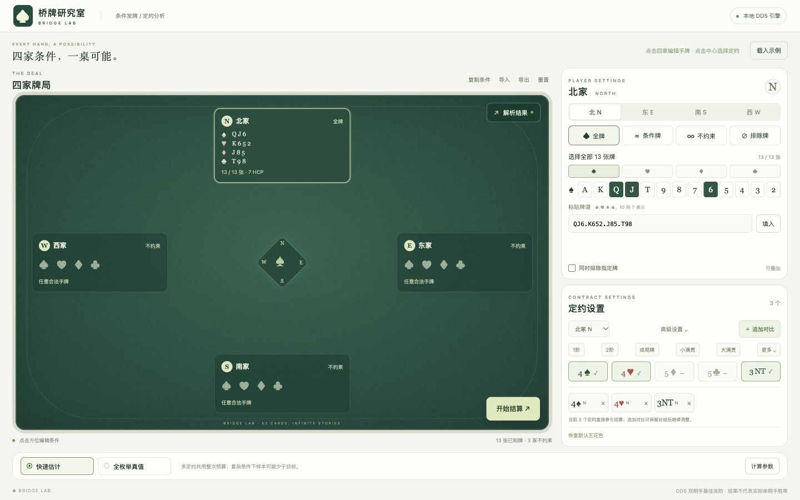
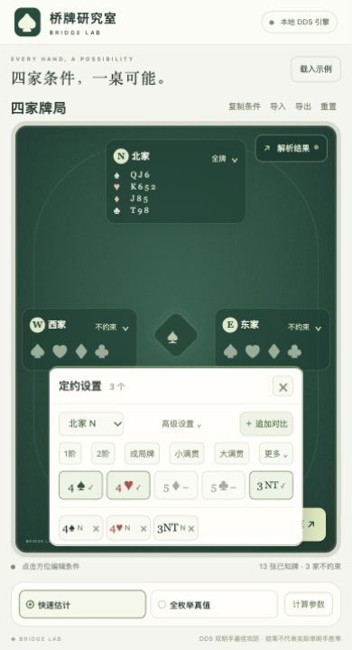
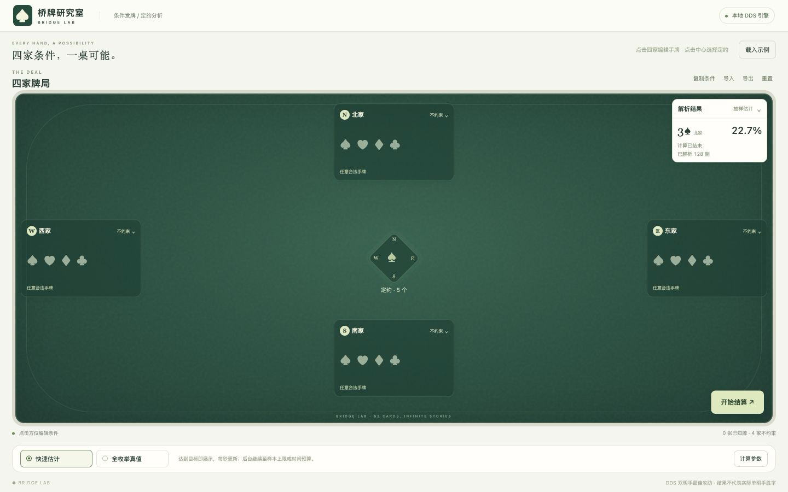
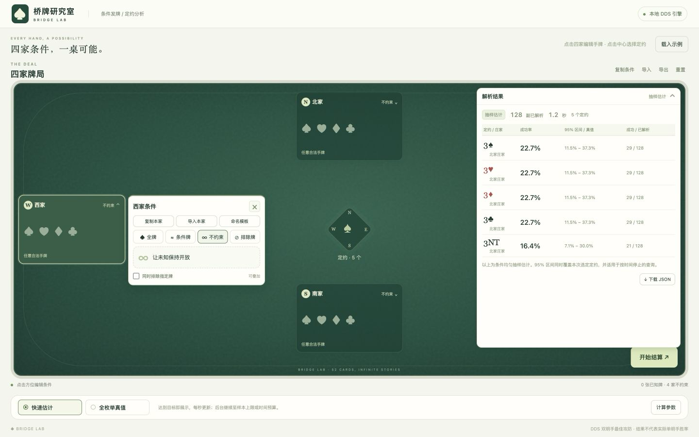
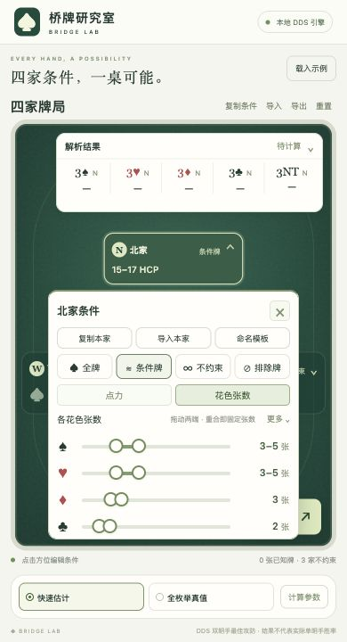
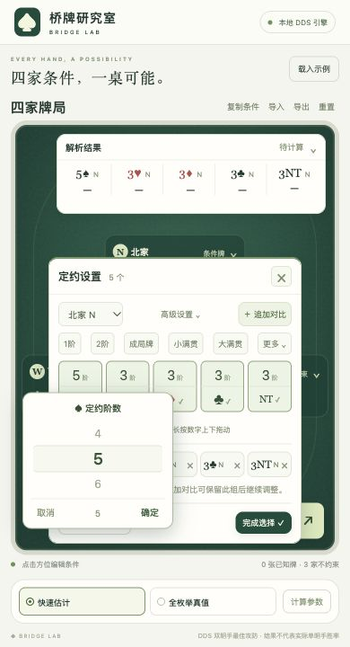

# BridgeDealer · 桥牌研究室

[](https://github.com/DAntyNoel/BridgeDealer/actions/workflows/ci.yml)

给四家设置已知牌、牌型、点力和排除牌，生成合法牌局，再用 **DDS 3.1.0** 比较不同定约的双明手成约率。
仓库包含网页前端、Python 后端、DDS 原生源码、构建脚本、测试及实验文档。无需 Node 服务或前端打包。



## 功能

- 四家可分别设置：全牌、部分已知牌、花色长度、有序/无序/并集牌型、HCP 点力范围、不约束、明确排除某些牌；条件取交集。
- v2 对支持的已知牌/牌型条件精确计数、均匀采样；CP-SAT 支持通用条件可行性检查和不重不漏的完整枚举。
- 一个或多个定约共享样本与总预算，支持 4 位庄家 × 7 阶 × 5 花色，共 140 个不同定约。
- 快速估计默认 **20 秒、8 线程、目标至少 10,000 副、上限 100,000 副**；达到目标立即展示，后台继续至上限或预算，每秒更新实际样本数和同时置信区间。
- 不限时真值模式枚举所有合法牌并逐副求解，只有穷尽后才标记 `exact`；达到目标后每秒展示总体概率上下界，支持取消和当前服务内刷新恢复任务。
- 固定视口牌桌；点四家或中心盘展开紧凑设置；右上常驻定约概率，点击展开详情，始终可继续操作牌桌。
- 定约快捷填入 1阶、2阶、成局牌、小满贯、大满贯；“更多”展开 3/4/5阶，高级设置允许各花色独立阶数。
  点“成局牌”，关闭低花即可比较 **3NT、4S、4H**；“追加对比”支持更多庄家或阶数。
- 条件一键复制、粘贴/文件导入、JSON 导出；结果也可下载 JSON。
- 每家可单独复制、导入限制条件，保存为可命名的本地模板，并用于任意一家；支持更新、改名和删除模板。

概率以满足条件的具体完整牌局为均匀总体，含义为 **DDS 双明手最佳攻防下的成约率**，不等同于实战胜率。
20 秒和一万副是预算与采样目标，复杂条件、机器性能或同时比较大量定约会影响完成量，程序会如实报告不足。

## 安装

推荐 **Python 3.12 + uv**。支持 macOS 和 Linux；Windows 使用 WSL2 Ubuntu，以下命令在 WSL 终端执行。
DDS 在本机编译，无需下载第三方预编译动态库，也无需克隆子模块。

先安装 Git、CMake ≥ 3.16 和支持 C++20 的编译器：

```bash
# macOS：安装 Xcode Command Line Tools，CMake 可由 Homebrew 安装。
xcode-select --install
brew install cmake

# Ubuntu / Debian / WSL2：使用较新的系统，例如 Ubuntu 24.04。
sudo apt update
sudo apt install -y git build-essential cmake
```

按 [uv 官方说明](https://docs.astral.sh/uv/getting-started/installation/) 安装 uv，例如：

```bash
curl -LsSf https://astral.sh/uv/install.sh | sh
# 安装后重开终端，或按安装器提示将 uv 加入 PATH。
```

随后：

```bash
git clone https://github.com/DAntyNoel/BridgeDealer.git
cd BridgeDealer
uv sync --locked --python 3.12
uv run --locked python scripts/build_dds.py
./dealer serve
```

浏览器打开 **http://127.0.0.1:8789**。结束服务按 `Ctrl-C`；端口占用时用 `./dealer serve --port 8790`。
网页静态资源随项目提供，不依赖外部 CDN；安装完成后日常查询可以离线运行。
服务监听本机地址；窄屏布局可在同一浏览器的移动视口中使用。

使用 Cloudflare Tunnel 转发时，显式允许唯一的 HTTPS 公网来源，例如：

```bash
.venv/bin/python -m bridge_dealer serve --port 12707 --public-origin https://bridge.kanami.top
```

cloudflared 与服务处于同一网络命名空间时，Tunnel 回源填写 `http://127.0.0.1:12707`；
Windows Docker connector 使用 `http://host.docker.internal:12707`。保留公网 `Host: bridge.kanami.top`，服务仍只监听 `127.0.0.1`。
省略 `--public-origin` 时只允许本机访问。来源白名单不是用户认证，所有访问者共享解析任务和模板，
可以查看、取消任务及修改模板；建议先用 Cloudflare Access 限制指定用户再开放。详见[转发说明](docs/web-workbench.md#通过-cloudflare-tunnel-访问)。
Windows 可使用[本地部署与启动说明](docs/windows-deployment.md)。

构建结果为 `lib/libdds.dylib`（macOS）或 `lib/libdds.so`（Linux/WSL2）。后端自动查找本仓库的 `lib/`。
也可用 `BRIDGE_DDS_LIBRARY=/absolute/path/to/libdds.so` 或 CLI 的 `--dds-library` 指定 **3.1.0** 库。
`uv sync` 默认以 editable 模式安装；若将 Python 包单独安装到别处，需显式指定动态库路径。

无需 uv 时，也可创建 Python 3.12 venv 并执行 `python -m pip install -e .`，
随后用 `python scripts/build_dds.py` 构建，`python -m bridge_dealer serve` 启动。
推荐上面的锁定 uv 流程，以获得一致的依赖版本。

## 网页使用

1. 点击某家，在牌桌内展开紧凑条件菜单；北家菜单在卡片下方展开。按花色选牌，或填写点力和花色张数；排除牌可与其他条件叠加。
2. 点击牌桌中心，就地选择庄家、阶数和查询花色。可以跳过此步，默认北家 3S/3H/3D/3C/3NT。
3. 展开右上角“解析结果”，选择“快速估计”或“全枚举真值”；需要时展开其中的“计算参数”，然后点击右下“开始结算”。
4. 牌桌右上角缩略框显示最高胜率定约、胜率、后台状态和已解析副数，不遮挡四家卡片。点击展开区间、样本数和停止原因，需要时导出结果；详情可覆盖牌桌，四家尺寸和位置保持固定。

条件工具只导入/导出四家限制条件；定约和计算参数单独调整。详见 [网页与 HTTP 接口](docs/web-workbench.md)。
条件和定约菜单每次展开一个，支持再次点击入口、点击空白或按 Esc 收起；窄屏菜单在牌桌内滚动。查询方式和计算参数集中在“解析结果”展开区，收起结果后隐藏。
点力和花色张数默认使用双端范围条；“更多”提供分别填写上下限。手机点数字可用拨盘，
电脑长按数字上下拖动可快速调整，也可直接输入；定约阶数与花色开关分开操作。
玩家编辑器关闭按钮旁的“☰”菜单默认收起，提供“复制条件（JSON）”“导入条件”“保存条件”，只处理当前一家；“保存条件”可保存、选择和应用单家条件模板。
模板写入本仓库的 `user_data/hand-templates.json`，跨浏览器和服务重启保留；此目录已被 Git 忽略。
备份或迁移模板时复制该文件即可。

<details>
<summary>窄屏牌桌内定约菜单截图</summary>



</details>

<details>
<summary>牌桌右上角解析结果截图</summary>

简版显示最高胜率定约、后台计算状态和已解析副数；四家卡片尺寸和位置固定：



展开详情可覆盖牌桌，收起后四家位置保持原样：



</details>

<details>
<summary>手机范围条与数字拨盘截图</summary>

默认拖动范围条，“更多”中保留精确端点输入：



上下拨动阶数，确认后应用；花色开关独立保留：



</details>

## 命令行

```bash
# 给定北家全牌，v2 均匀发 10 万副；输出文件不得已存在。
./dealer random examples/v2_fixed_one.json --backend v2 \
  --count 100000 --seed 12345 --output sample100k.pbn

# 北家全牌 + 其他三家牌型，发 10 万副。
./dealer random examples/v2_fixed_one_three_shapes.json --backend v2 \
  --count 100000 --seed 12345 --output shaped100k.pbn

# 两家全牌已知，枚举另两家全部分布（C(26,13) = 10,400,600 副）。
./dealer enumerate examples/v2_fixed_two.json --backend v2 --output all.pbn

# 北家三阶，默认五种花色和整次 20 秒预算。
./dealer success examples/v2_fixed_one.json --seed 12345

# 南家 4S / 4H，可调整时间和样本上限。
./dealer success examples/north_south.json \
  --declarer S --level 4 --strains S,H --budget 20 --max-samples 50000

# 85 副小空间不限时真值，用于安装自检。
./dealer success examples/four_hands_85.json --exact

# 通用条件可行性检查与受限枚举。
./dealer check examples/north_south.json
./dealer enumerate examples/four_shapes.json --limit 100 --time-limit 10 --format jsonl
```

普通 `random` / `enumerate` 默认 v1；v2 需显式 `--backend v2`。
v2 的已知牌/牌型编译器不支持未固定玩家的额外 HCP 筛选和 `exclude`，会明确报错；这类发牌条件用 v1。
`success` 和网页自动选择完整的合法抽样/枚举策略，支持点力与排除牌，不需要指定 backend。

牌局写入 stdout，最后一行 JSON 运行报告写入 stderr。`success` 的 stdout 是一份完整结果 JSON。
退出码：0 正常，1 无解，2 输入或运行错误，3 快速查询样本不足，130 用户中断。
`--exact` 忽略预算和样本上限，只有 `status: exact` 才是真值；宽松条件的全枚举可能需要极长时间。
全部桥牌完整分布有 `52!/(13!)⁴ ≈ 5.36×10²⁸` 副，建议先用小空间牌例验证。

## 条件 JSON

根对象按 N/E/S/W 表示四家，省略某家表示不约束。花色顺序始终为 **S/H/D/C**；牌面使用 `AKQJT98765432`，10 写作 `T`。
`predeal` 和 `exclude` 使用四段点分牌谱，空花色留空，例如 `A...` 表示黑桃 A。

```json
{
  "N": {"predeal": "QJ6.K652.J85.T98"},
  "E": {"hcp": [8, 15], "shape_any": [5, 3, 3, 2], "exclude": "A..."},
  "S": {"hcp": [10, 20]},
  "W": {}
}
```

| 字段 | 示例 | 含义 |
| --- | --- | --- |
| `predeal` | `"AKQJ..."` | 必须持有的牌，0～13 张；13 张即全牌 |
| `exclude` | `"A.K.."` | 明确不能持有的牌；可与其他字段叠加 |
| `hcp` | `12` 或 `[12,16]` | 精确点力或闭区间；A/K/Q/J = 4/3/2/1 |
| `shape` | `[5,3,3,2]` | S/H/D/C 的固定长度 |
| `shapes` | `[[5,3,3,2],[5,4,2,2]]` | 有序牌型的并集 |
| `shape_any` | `[5,3,3,2]` | 无序牌型，允许所有不同花色排列 |

每家 `shape` / `shapes` / `shape_any` 三选一，其他字段取交集。
牌型四个长度必须加起来为 13；未知字段、重复牌或矛盾输入会被拒绝，或经求解证明无解。

## Python API 与 HTTP

```python
from bridge_dealer import query_success

result = query_success(
    {"N": {"hcp": [12, 16]}, "S": {"hcp": [8, 12]}},
    contracts=[
        {"declarer": "N", "level": 3, "strain": "NT"},
        {"declarer": "N", "level": 4, "strain": "S"},
        {"declarer": "N", "level": 4, "strain": "H"},
    ],
    budget_seconds=20,
    seed=12345,
)
print(result["status"], result["samples"], result["results"])
# 小空间全枚举：query_success(conditions, contracts=[...], exact=True)
```

HTTP 使用异步任务：`POST /api/jobs` 提交，`GET /api/jobs/{id}` 查进度和结果，
`POST /api/jobs/{id}/cancel` 取消。每个服务同时运行一个解析任务，保留最近 20 次任务；
重启服务后任务记录清空。完整请求格式见 [接口文档](docs/web-workbench.md#http-接口)。

## 验证与开发

```bash
uv run --locked pytest -q
uv run --locked ruff check src tests scripts
uv run --locked ruff format --check src tests scripts
node --check src/bridge_dealer/static/app.js  # 仅开发检查需要 Node
```

回归覆盖独立组合枚举 oracle、条件抽样、DDS 官方牌例的 420 个定约判断、
原生批量求解与独立 context 一致性、85 副真值、排除条件和真实 HTTP 查询。
GitHub Actions 在 Ubuntu 24.04 和 macOS 14 从源码编译 DDS 并运行完整测试。
实验脚本在 `research/`；历史实验文档记录当时环境和结果，不代表所有机器的吞吐保证。

| 路径 | 内容 |
| --- | --- |
| `src/bridge_dealer/static/` | HTML/CSS/JavaScript 前端 |
| `src/bridge_dealer/` | 条件、发牌、枚举、DDS、CLI 与 HTTP 后端 |
| `vendor/dds/library/src/` | 固定 DDS 3.1.0 源码与 C ABI |
| `scripts/build_dds.py`、`CMakeLists.txt` | 本机 DDS 构建入口 |
| `tests/`、`examples/` | 回归测试与可运行条件 JSON |
| `docs/`、`research/` | 设计、统计口径、使用说明和实验 |

## 常见问题

- **找不到 DDS**：先运行构建脚本；检查 `BRIDGE_DDS_LIBRARY` 是否覆盖了自动路径。其他版本会被 ABI 检查拒绝。
- **CMake / C++ 编译失败**：检查 CMake 和编译器已安装且支持 C++20；内存较小时用 `--jobs 2`。
  更换编译器后删除 `build/dds/` 再构建。构建不需要 Bazel、LLVM 工具链下载或 DDS Python 绑定。
- **uv 下载依赖失败**：检查网络并重试 `uv sync --locked --python 3.12`。锁定依赖目前按 Python 3.12 验证。
- **样本少于 10,000**：查看停止原因、区间和条件稀有程度；可增加预算或减少对比定约。样本不足不等于无解。
- **真值计算很久**：两家全牌已知仍有一千多万副合法分布；可在网页取消，或 CLI 按 `Ctrl-C`。
- **手机无法访问电脑的地址**：当前服务仅绑定 loopback，主要作为本机工作台；手机布局不表示已开放局域网服务。

## 文档与许可

- [网页使用与 API](docs/web-workbench.md)
- [DDS 成约率、预算与统计口径](docs/contract-success.md)
- [v2 发牌实验与支持范围](docs/v2-target-experiment.md)
- [采样数学模型](docs/v2-mathematical-model.md)
- [DDS 优化实验](docs/success-optimization.md)

本项目原创代码采用 [MIT](LICENSE)；DDS 采用 [Apache-2.0](vendor/dds/LICENSE)。
固定版本来源与第三方归属见 [vendor/README.md](vendor/README.md) 和 [THIRD_PARTY_NOTICES.md](THIRD_PARTY_NOTICES.md)。
